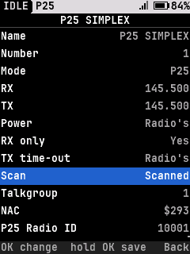

<!-- SPDX-License-Identifier: MIT -->
<!-- Copyright (c) 2026 Open25-DM32 Contributors -->

  

# Open25-DM32

**Experimental firmware for the Baofeng DM-32UV, with two editions: Classic and Next.**

> [!CAUTION]
>
> ### ⚠️ IMPORTANT — FCC Warning & Disclaimer
>
> **Open25-DM32 is experimental firmware. It is NOT approved for commercial, public safety, emergency, or other critical communications.**
>
> **FCC Certification:** The Baofeng DM-32UV is FCC Part 90 certified for certain DMR and analog FM transmissions. **It is NOT certified for P25.** Installing this firmware does not change that certification or make the radio legal to use for P25 on commercial or public safety radio systems.
>
> **Transmit Restrictions:** To help prevent illegal use, this firmware blocks P25 transmission on certain frequencies commonly used by police, fire, EMS, and other public safety agencies. The radio may still receive signals on these frequencies, but transmitting P25 is blocked.
>
> **These restrictions do not cover every public safety frequency.** Just because the firmware allows you to transmit on a frequency does not mean you are legally allowed to use it. See the frequency table for a full list of allowed P25 transmit ranges.
>
> **Your Responsibility:** You are responsible for following FCC rules and making sure you have permission to transmit. Do not use this firmware to access, interfere with, or transmit on public safety radio systems. Keep in mind that P25 trunked radios may transmit registration and affiliation messages even when you are not pressing PTT.
>
> **Disclaimer:** This firmware is provided **AS IS**, with no warranty. The developers are not responsible for illegal transmissions, interference, FCC fines, damaged radios, lost data, or any other problems caused by using this firmware, to the extent allowed by law.
>
> **DO NOT RELY ON THIS FIRMWARE FOR EMERGENCY COMMUNICATIONS.**

Open25-DM32 brings P25 to the DM-32, with programming from the radio's front
panel and browser tools for installation, programming, backup and recovery.
Both current builds include analog FM, DMR, conventional P25 and NXDN 4800/9600.
Classic keeps the RadioFoundry interface. Next adds a different interface and
P25 Phase 1 trunking.

**[Open the tools](https://kd8zmm.com/open25-dm32/)** ·
**[Classic CPS](https://kd8zmm.com/open25-dm32/classic-cps/)** ·
**[Next CPS](https://kd8zmm.com/open25-dm32/cps/)** ·
**[Flasher v3](https://kd8zmm.com/open25-dm32/v3/firmware.html)**

Report firmware and P25 problems to **[Open25-DM32 issues](https://github.com/tylerwatt12/Open25-DM32/issues)**.

## Choose your edition

| Open25-DM32 Classic | Open25-DM32 Next |
| :---: | :---: |
|  |  |
| RadioFoundry interface with an Open25 / CLASSIC Home band | New interface with clock and a banner-free Home screen |
|  |  |
| Conventional P25: NAC, contact target and radio ID | Trunked P25: systems, sites, WACN and System ID |
| **[0.1.0-rc1-r14 release candidate available](https://github.com/tylerwatt12/Open25-DM32/releases/tag/classic-0.1.0-rc1-r14)** | **Private development build · not publicly released** |

These screen examples use synthetic programming and the current native
renderers. Next is shown in light mode with its new glyphs. Both editions have
the Open25 signal-ring boot emblem. Classic keeps
its Home identity band; Next's Home banner has been removed. Both have light
and dark themes.

| Feature | Classic r14 | Next development build |
| --- | --- | --- |
| Analog FM | ✅ | ✅ |
| Conventional DMR | ✅ | ✅ |
| Conventional P25 Phase 1 | ✅ | ✅ |
| NXDN 4800 / 9600 | ✅ | ✅ |
| Trunked P25 Phase 1 | ❌ | ✅ |
| P25 encryption | ❌ | ✅ AES-256, DES-OFB, ADP/RC4 |
| Programming | Front panel · matched Classic CPS | Front panel · matching Next CPS development tools |
| Extended RX included by default | ✅ | ✅ |
| Source in this repository | ✅ | ❌ Private |

### Unreleased source update

Current `main` includes a P25 transmit guard adapted from
[RadioFoundry PR #745](https://github.com/RadioFoundry/RadioFoundry/pull/745).
Either WACN `BEE00`–`BEEFF` or System ID `00A` blocks P25 transmission when
that system identity is known. Trunking-enabled builds also refuse registration
and affiliation and wait for verified serving-system identity before access.
Reception remains available, and the guard has no override.

Ordinary conventional P25 uses NAC, unit and talkgroup IDs. The conventional
receive path applies this guard only if validated system-status link control
reveals a blocked trunked identity; it never treats a NAC as a System ID.
Observed carrier blocks last until reboot. This source does not add trunking
to the default Classic feature set.

Current `main` also has two repairs that the r14 download does not:

- **Digital transmit after an FM channel with a receive tone.** r14 leaves the
  RF chip's sub-audio on when the radio goes from an FM channel with a receive
  CTCSS or DCS tone to a DMR, P25 or NXDN channel. The tone then rides on every
  digital transmission, and none decodes until the radio is switched off and
  on, or an FM channel without a receive tone is selected first. This matches
  the report in [#56](https://github.com/tylerwatt12/Open25-DM32/issues/56).
  r13 carried a repair for this that the r14 source layout lost; this one is
  RadioFoundry's
  ([#825](https://github.com/RadioFoundry/RadioFoundry/pull/825)).
- **Battery level while transmitting.** The status bar read the battery all
  through a transmission, so the charge shown fell while the radio was keyed
  and came back afterwards
  ([#59](https://github.com/tylerwatt12/Open25-DM32/issues/59)). No reading is
  taken now while keyed or for three seconds after.

Dual watch and the GPS receiver are switched back on in the Classic profile.
The r14 profile turned both off
([#54](https://github.com/tylerwatt12/Open25-DM32/issues/54),
[#39](https://github.com/tylerwatt12/Open25-DM32/issues/39)). Neither has been
tested on a radio with this source.

This is source-only development version `open25-classic-0.1.0-rc1-r15-dev`.
Host regressions pass. With these changes the firmware builds without
warnings, passes the stack check and rebuilds identically on RadioFoundry's
GCC 14.2.0 toolchain image. It has not been rebuilt with the exact release
toolchain, so the release pins are empty (see [BUILD.md](BUILD.md)). New RF
qualification is pending. The downloadable release remains r14. To reproduce
released r14, use the `classic-0.1.0-rc1-r14` tag.

## Get started

**Classic r14 is available now.** Next is still in development and has no public
firmware download. See the [release notes](https://github.com/tylerwatt12/Open25-DM32/releases)
for earlier versions.

1. Open [Flasher v3](https://kd8zmm.com/open25-dm32/v3/firmware.html) in desktop Chrome or Edge.
2. Connect your DM-32UV and choose **Classic → Standard · DM-32UV**.
3. Save a full-radio backup and keep it somewhere safe. A CPS settings file is not a full backup. Only restore a backup to the radio it came from.
4. Follow the flasher's steps to install the firmware. If it asks you to save a recovery ZIP, keep that too.
5. Open [Classic CPS](https://kd8zmm.com/open25-dm32/classic-cps/) and choose **Read from Radio** before making changes.

### Upgrading from r13

The flasher can convert settings from the published r13 build to r14. It checks
the radio first and requires a saved recovery ZIP before making changes.

**Do not write an old r13 settings file or saved draft to r14.** P25 settings
now use contacts to choose who you call. Use the r14 profile in Classic CPS.
Switching CPS profiles does not convert an old file.

Other firmware versions do not have a supported direct upgrade to r14.
The [older r13 package](https://kd8zmm.com/open25-dm32/releases/classic/standard/Open25-DM32-Classic-0.1.0-rc1-r13-p25-tx-cleanup-application.zip)
can be used as an extra step for compatible installations through the flasher's
local-file option. Check compatibility first; older settings may need to be
entered again. A recovery ZIP does not replace your full-radio backup.

## Programming

Both editions can be programmed from the radio's buttons. For browser programming,
use **[Classic CPS](https://kd8zmm.com/open25-dm32/classic-cps/)** for Classic and
**[Next CPS](https://kd8zmm.com/open25-dm32/cps/)** for a matching Next build.
Their settings files are not interchangeable.

Classic r14 supports P25 group, private and all-call contacts, with separate
receive and transmit NACs. The CPS also supports FM, DMR and NXDN.

## Frequency table

Applies to both builds. All ranges are in MHz.

| Frequency range (MHz) | TX | RX |
| --- | --- | --- |
| 16–65 | ❌ | FM, DMR, P25, NXDN |
| 136–144 | FM, DMR, NXDN | FM, DMR, P25, NXDN |
| 144–148 (US 2M HAM) | FM, DMR, P25, NXDN | FM, DMR, P25, NXDN |
| 148–151.820 | FM, DMR, NXDN | FM, DMR, P25, NXDN |
| 151.820–151.940 (MURS) | FM, DMR, P25, NXDN | FM, DMR, P25, NXDN |
| 151.940–154.570 | FM, DMR, NXDN | FM, DMR, P25, NXDN |
| 154.570–154.600 (MURS) | FM, DMR, P25, NXDN | FM, DMR, P25, NXDN |
| 154.600–174 | FM, DMR, NXDN | FM, DMR, P25, NXDN |
| 174–400 | ❌ | FM, DMR, P25, NXDN |
| 400–420 | FM, DMR, NXDN | FM, DMR, P25, NXDN |
| 420–450 (US 70CM HAM) | FM, DMR, P25, NXDN | FM, DMR, P25, NXDN |
| 450–462.550 | FM, DMR, NXDN | FM, DMR, P25, NXDN |
| 462.550–462.725 (FRS/GMRS) | FM, DMR, P25, NXDN | FM, DMR, P25, NXDN |
| 462.725–467.550 | FM, DMR, NXDN | FM, DMR, P25, NXDN |
| 467.550–467.725 (FRS/GMRS) | FM, DMR, P25, NXDN | FM, DMR, P25, NXDN |
| 467.725–480 | FM, DMR, NXDN | FM, DMR, P25, NXDN |
| 480–700 | ❌ | FM, DMR, P25, NXDN |
| 700–740 (Experimental with significantly reduced sensitivity) | ❌ | FM, DMR, P25, NXDN |
| 764–776 (Experimental with significantly reduced sensitivity) | ❌ | FM, DMR, P25, NXDN |
| 794–824 (Experimental with significantly reduced sensitivity) | ❌ | FM, DMR, P25, NXDN |
| 851–870 (Experimental with significantly reduced sensitivity) | ❌ | FM, DMR, P25, NXDN |

## Known limits

- P25 Phase 2 and LSM are not supported.
- Extended 700/800 MHz reception has not been fully tested on the hardware.
- Classic P25 transmit audio can be quieter than Next.
- Startup and programming-cable problems, NXDN recovery after damaged signals, and behavior during long periods of traffic are still being checked.
- CTCSS tones may drop while sending DTMF keypad tones.
- P25 and NXDN channels have no talk permit tone. DMR plays it just before keying.
- The FM broadcast receiver is not in the Classic profile (`overlay/config/variants/classic.mk` turns it off).

Testing is ongoing. Support for a feature does not guarantee it will work with
every radio or system.

## Source and credits

Classic builds on [RadioFoundry](https://github.com/RadioFoundry/RadioFoundry).
See [LICENSE](LICENSE), [LICENSES](LICENSES), [notices](notices) and
[FORKING.md](FORKING.md) for licenses and credits, including the ISC mbelib notice.

This repository contains **Classic source only**. Next source is private.
Firmware downloads are hosted on kd8zmm.com.
**[BUILD.md](BUILD.md)** has the source and build instructions.

## Support the project

Donations help pay for development and testing:
[GitHub Sponsors](https://github.com/sponsors/tylerwatt12?metadata_project=open25-dm32) ·
[Ko-fi](https://ko-fi.com/kd8zmm).

Report bugs through [GitHub Issues](https://github.com/tylerwatt12/Open25-DM32/issues).
Include your edition, version, radio model and steps to repeat the problem.
Keep backups, keys and private radio data out of public reports.
