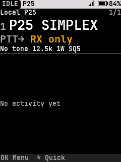
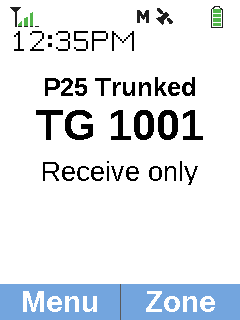
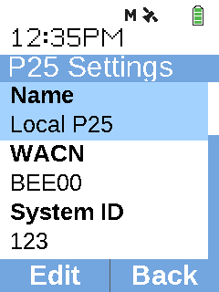

# Open25-DM32

**Alpha firmware for the Baofeng DM-32UV, with two editions: Classic and Next.**

Open25-DM32 brings P25 to the DM-32, with on-radio programming and tools for
firmware installation, backup, and recovery. Classic has a compact
interface with a white default theme, FM, DMR, and conventional P25. Next
introduces a new interface with FM and conventional/trunked P25.

Report firmware and P25 problems to **[Open25-DM32 issues](https://github.com/tylerwatt12/Open25-DM32/issues)**.

**[Open the tools](https://kd8zmm.com/open25-dm32/)** ·
**[Classic CPS](https://kd8zmm.com/open25-dm32/classic-cps/)** ·
**[Next CPS](https://kd8zmm.com/open25-dm32/cps/)** ·
**[Flasher v3](https://kd8zmm.com/open25-dm32/v3/firmware.html)**

## Choose your edition

| Open25-DM32 Classic | Open25-DM32 Next |
| :---: | :---: |
|  |  |
| Conventional P25 · White default theme | Trunked P25 · New interface |
|  |  |
| P25 channel settings: talkgroup, NAC, and radio ID | Trunked system settings: WACN and System ID |
| **0.1.0-rc1-r12 release candidate available** | **In development · source private.** |

| Feature | Classic | Next |
| --- | --- | --- |
| Analog FM | ✅ | ✅ |
| DMR | ✅ | ❌ |
| Conventional P25 | ✅ | ✅ |
| Trunked P25 Phase 1 | ❌ | ✅ |
| P25 encryption | ❌ | ✅ AES-256, DES-OFB, ADP/RC4 |
| Programming | FPP · Classic CPS (FM/DMR/P25) | FPP · Next CPS |

FPP means programming from the radio's front panel. **Open25-DM32 Classic CPS**
supports Open25-DM32 Classic firmware R9 and newer, with FM, DMR and
conventional P25 channels, including separate RX and TX NACs, talkgroup and
radio ID. Use Classic CPS for Classic and Next CPS for Next; their supported
modes and firmware requirements differ.

The tools homepage lists Flasher v3, Classic CPS and Next CPS. Retired Flasher
v1/v2 choices are removed; their former public entry URLs redirect to
[Flasher v3](https://kd8zmm.com/open25-dm32/v3/firmware.html).

Classic can scan saved conventional P25 channels alongside FM and DMR using
**Tools > Scan**. It follows the zone order and each channel's Scan setting.
A quiet P25 stop gets at least 450 ms after the receiver starts. Scan holds when
the channel's NAC and talkgroup settings admit decoded voice. While searching
on a P25 channel, the first PTT press stops scan. Release and press again to
transmit. Classic P25 uses saved channels and group calls.

Next adds zones and scan lists, receive-only control-channel monitoring, site
discovery, caller aliases, recent calls, and light/dark display modes.
Encryption support is still being tested with other radios and systems.

**P25 Phase 2, LSM, and 700/800 MHz reception are not supported.**

## Release status

**Classic and Next are alpha firmware, and testing is still underway.**
Classic **0.1.0-rc1-r12** is available in the
[Flasher v3](https://kd8zmm.com/open25-dm32/v3/firmware.html), under
**Open25-DM32 Classic → Standard · DM-32UV**. Final on-air qualification is
incomplete; compatibility with every DM-32UV hardware revision is not established.
Next remains unavailable, with its release date to be determined.

Revision r12 keeps the speaker FIFO fed by a 2 ms hardware timer while the
block callback runs, and uses the existing scratch memory as one extra queued
block. A block can now be queued when space becomes free during its callback;
transmit and route changes still discard stale audio. P25 gain, the IMBE codec,
RFKV programming and supported modes are unchanged. The newer RadioFoundry
codec's gain correction does not apply to this Classic codec. Full host,
sanitizer, target stack/ABI and reproducible-build checks cover this release;
physical-radio qualification of r12 has not been performed.

Revision r11 fixes the missing P25 choice in Classic CPS after connecting to
the radio (issue #27). The firmware now advertises its saved conventional P25
capability in the VERSION response. Existing RFKV programming and the r10
RX-only defaults are preserved. Regression tests exercise the real firmware
VERSION handler and verify P25 selection in a codeplug with no P25 channels.

Revision r10 adds an RX-only default and one explicit transmit confirmation to
Classic and its matching CPS. New or copied channels whose actual TX frequency
is outside **144–148 MHz** or **420–450 MHz** start RX-only. Changing the actual
TX frequency outside those ranges restores RX-only. Actual TX uses RX when
Talkaround is enabled or no TX frequency is set; otherwise it uses TX.

Turning RX-only off outside those bands opens **Enable TX?**, showing the TX
frequency. **Keep RX-only** is selected by default; choose **Enable TX** to
allow transmitting. There is no prompt on each PTT press. Existing RFKV
programming and imports keep their saved RX-only choices. Enabling TX does not
bypass the existing P25 band restriction or normal transmit checks.

Revision r9 switches saved P25 programming to RadioFoundry RFKV mode records
and is released with the matching Classic CPS. Retired Classic A5/D/E records
are no longer read or converted. Recreate older programming in the current CPS;
the radio preserves unsupported old bytes until an explicit **Start new**.
The software suites cover refusal without writes, explicit initialization,
RFKV storage and P25 target validation. On-radio qualification of this revision
remains incomplete; the existing intermittent P25 startup and PL/DTMF limitations
remain documented below.

Revision r8 publishes the project firmware, P25 CAI library and full-rate IMBE
codec under MIT, with the dependencies' original notices retained. It adds
separate RX/TX NAC settings, fixes silent first DMR transmissions caused by a
microphone-routing timing gap, and adds small P25 microphone and amplifier
changes to address startup clicks and idle hiss.

The first-call DMR fix was confirmed on a DM-32UV. Full software regression,
sanitizer, target stack/ABI checks and reproducible rebuild checks pass.
P25 acoustic changes and every hardware revision have not been fully qualified.

**Known issues:** PL/CTCSS signaling can drop while transmitting DTMF. An
intermittent P25 PTT startup failure with no RF has been reported and remains
under investigation.

TX NAC defaults to **Same as RX**. It inherits the receive NAC, using `293`
when RX is wildcard `F7E`. An explicit TX NAC, including `000` or a number equal
to RX, stays fixed when RX changes. Explicit TX `F7E` and `F7F` are refused.

Revision r6 added RadioFoundry-compatible codec layouts through NRFB .050 and
extended the modem table window to match. The flasher uses the codec
read from your own radio. No proprietary codec is included.

Revision r5 fixed **Start new** when the radio still contains another firmware's
settings. It initializes Classic's storage only after that choice and reports
success after the new codeplug and requested edit are saved.

This repository contains **Classic source only**. Next source remains private.
Firmware ZIPs are hosted on kd8zmm.com; GitHub contains no firmware downloads.
See [BUILD.md](BUILD.md) to build Classic and its application-only installer ZIP,
and [THIRD_PARTY.md](THIRD_PARTY.md) for dependency notices.

### Installing Classic

1. Open [Flasher v3](https://kd8zmm.com/open25-dm32/v3/firmware.html) in desktop Chrome or Edge and select Classic.
2. Connect the radio and select the release candidate.
3. Save and keep a verified full-radio backup before installing.
4. Install the selected package and check that the radio starts normally.

The package contains no proprietary DMR codec. The installer checks and preserves
a compatible codec in the reserved location. For first installation from
recognized OEM codec layouts (.032 through NRFB .050), it prepares the radio's
own codec in that blank slot. Unknown layouts or a damaged reserved slot stop before writing.
The bootloader and data flash are preserved during installation. Full-backup
restoration can replace both complete flash images. Keep backups private and
use only this radio's backup.

## Programming and firmware tools

- **[Next CPS](https://kd8zmm.com/open25-dm32/cps/):** program Next's channels,
  zones, talkgroups, and trunked systems from your browser. Read and write the
  radio over USB, or save your programming to a file.
- **[Classic CPS](https://kd8zmm.com/open25-dm32/classic-cps/):** program Classic's
  FM, DMR and conventional P25 channels in your browser, or save BIN/CSV files.
- **[Flasher v3](https://kd8zmm.com/open25-dm32/v3/firmware.html):** install
  or update firmware, make full-radio backups, restore a backup, or prepare a
  factory update file.

> [!WARNING]
> **THERE IS NO EASY WAY TO RESTORE THE RADIO WITHOUT A BACKUP.**
>
> **Keep a verified full-radio backup before installing firmware.**
> A CPS codeplug file is **not** a full firmware backup.
>
> **Use only DM-32 handheld hardware. Other models have not been validated.**
>
> **I am not responsible for bricked radios.**

Full backups can contain identifiers, keys, and factory calibration. Store them
privately and restore only a backup belonging to that same radio.

## Usage disclaimer

This firmware is for amateur radio, authorized P25 communications, and technical
research. Trunked monitoring is receive-only by default. The project does not
provide assistance with unauthorized system access, subscriber impersonation,
or bypassing system access controls.

**On trunked systems, registration and affiliation transmit even without pressing
PTT.** Only transmit on frequencies and systems you are authorized to use;
registration and affiliation require the system operator's permission.
Interference with public-safety communications can disrupt emergency response
and cause loss of life.

## Credits and license

Open25-DM32 builds on [RadioFoundry](https://github.com/RadioFoundry/RadioFoundry)
and other open-source projects. Project code, the P25 CAI library and the
shared fixed-point C full-rate IMBE codec use the [MIT license](LICENSE).
The earlier GPL IMBE implementation and patches are replaced in this source
release. Other dependencies retain their original terms.
Original dependency notices and attributions are preserved; see
[THIRD_PARTY.md](THIRD_PARTY.md) for the component licenses.

## Support development

Donations help cover development and testing expenses.

Report problems through [GitHub Issues](https://github.com/tylerwatt12/Open25-DM32/issues).
Include your edition, build, radio model, and steps to reproduce the problem.
Keep backups, keys, calibration, private identifiers, and private traffic out
of public reports.
