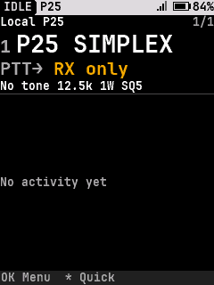
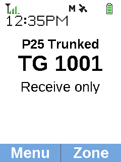
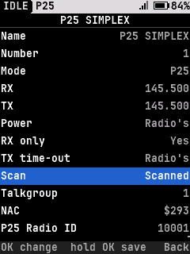
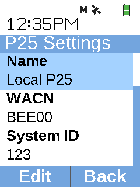

# Open25-DM32

**Alpha firmware for the Baofeng DM-32UV, with two editions: Classic and Next.**

Open25-DM32 brings P25 to the DM-32, with on-radio programming and tools for
firmware installation, backup, and recovery. Classic keeps the familiar
RadioFoundry interface with FM, DMR, and conventional P25. Next introduces a
new interface with FM and conventional/trunked P25.

**[Open the tools](https://kd8zmm.com/open25-dm32/)** ·
**[Next CPS](https://kd8zmm.com/open25-dm32/cps/)** ·
**[Firmware Utility](https://kd8zmm.com/open25-dm32/firmware.html)**

## Choose your edition

| Open25-DM32 Classic | Open25-DM32 Next |
| :---: | :---: |
|  |  |
| Conventional P25 · Original RadioFoundry interface | Trunked P25 · New interface |
|  |  |
| P25 channel settings: talkgroup, NAC, and radio ID | Trunked system settings: WACN and System ID |
| Planned first release | **Source will be provided on release.** |

| Feature | Classic | Next |
| --- | --- | --- |
| Analog FM | ✅ | ✅ |
| DMR | ✅ | ❌ |
| Conventional P25 | ✅ | ✅ |
| Trunked P25 Phase 1 | ❌ | ✅ |
| P25 encryption | ❌ | ✅ AES-256, DES-OFB, ADP/RC4 |
| Programming | FPP · RadioFoundry CPS (FM/DMR) | FPP · Browser CPS |

FPP means programming from the radio's front panel. **Classic P25 channels must
be programmed on the radio.** The RadioFoundry CPS does not recognize P25:
it displays those channels as FM, and editing one can change it to FM when
written back. Use its editor for FM/DMR channels only.

Classic's P25 operation uses saved channels. P25 scanning, VFO operation, and
private calls are not available in Classic.

Next adds zones and scan lists, receive-only control-channel monitoring, site
discovery, caller aliases, recent calls, and light/dark display modes.
Encryption support is still being tested with other radios and systems.

**P25 Phase 2, LSM, and 700/800 MHz reception are not supported.**

## Release plans

**Classic and Next are alpha firmware, and testing is still underway.**
Classic is planned for release first, followed by Next. Each release will
include firmware downloads, compatible-radio information, installation
instructions, and source code.

## Programming and firmware tools

- **[Next CPS](https://kd8zmm.com/open25-dm32/cps/):** program Next's channels,
  zones, talkgroups, and trunked systems from your browser. Read and write the
  radio over USB, or save your programming to a file.
- **[RadioFoundry CPS](https://radiofoundry.org/codeplug/index.html):** edit
  Classic's FM and DMR channels. Program Classic's P25 settings on the radio.
- **[Firmware Utility](https://kd8zmm.com/open25-dm32/firmware.html):** install
  compatible firmware packages, make verified full-radio backups, and restore
  your radio from its backup.

> [!WARNING]
> **THERE IS NO EASY WAY TO RESTORE THE RADIO WITHOUT A BACKUP.**
>
> **Keep a verified full-radio backup before installing firmware.**
> A CPS codeplug file is **not** a full firmware backup.
>
> **Use only DM-32 handheld hardware. Other models have not been validated.**
>
> **I am not responsible for bricked radios.**

Full backups can contain identifiers, keys, and factory calibration. Store them
privately and restore only a backup belonging to that same radio.

## Usage disclaimer

This firmware is for amateur radio, authorized P25 communications, and technical
research. Trunked monitoring is receive-only by default. The project does not
provide assistance with unauthorized system access, subscriber impersonation,
or bypassing system access controls.

**On trunked systems, registration and affiliation transmit even without pressing
PTT.** Only transmit on frequencies and systems you are authorized to use;
registration and affiliation require the system operator's permission.
Interference with public-safety communications can disrupt emergency response
and cause loss of life.

## Credits and license

Open25-DM32 builds on [RadioFoundry](https://github.com/RadioFoundry/RadioFoundry)
and other open-source projects. Project code is
[GPL-3.0-or-later](https://github.com/tylerwatt12/Open25-DM32/blob/main/LICENSE)
unless a file carries a different notice. Original license notices and
attributions are preserved with the relevant source.

## Support development

Donations help cover development and testing expenses.

Report problems through [GitHub Issues](https://github.com/tylerwatt12/Open25-DM32/issues).
Include your edition, build, radio model, and steps to reproduce the problem.
Keep backups, keys, calibration, private identifiers, and private traffic out
of public reports.
